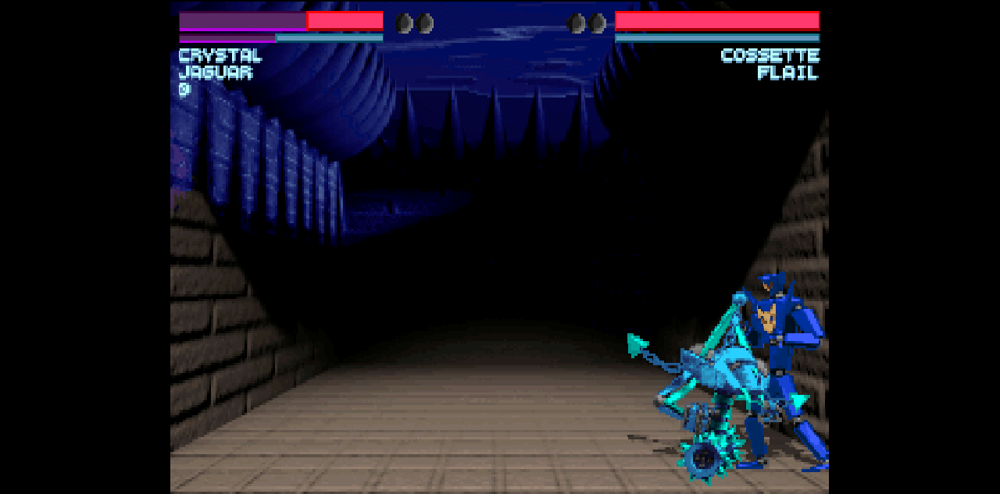
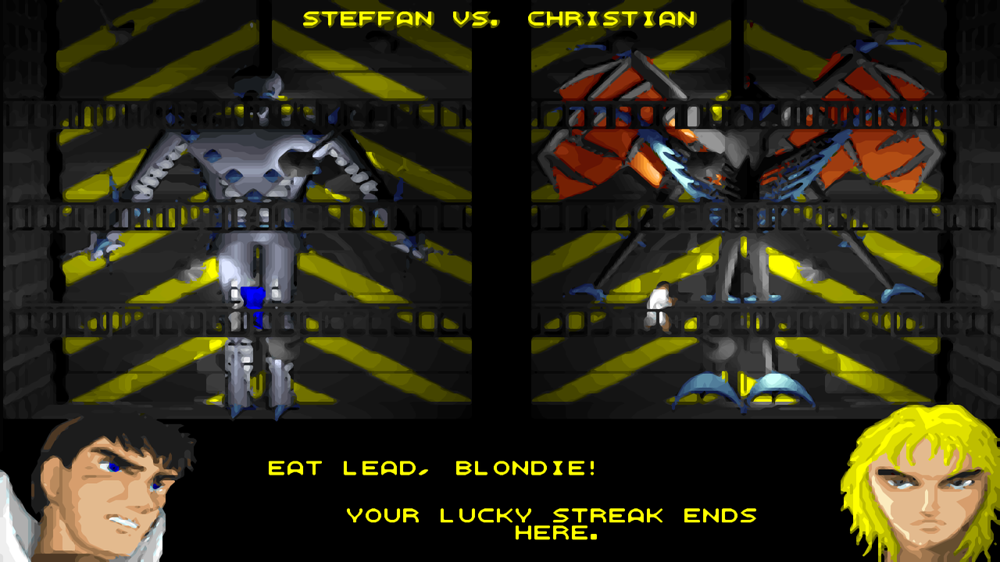
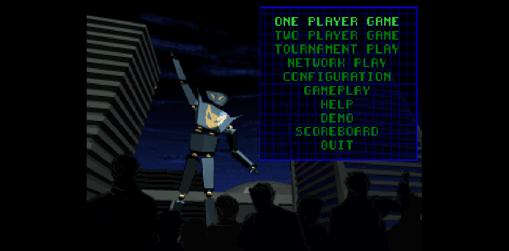

<div align="center">

# ONE MUST FALL 2097

### Il classico picchiaduro di robot del 1994, che gira in modo nativo nel tuo browser

[English](README.md) · **Italiano**


[](https://mich-de.github.io/omf2097/)

**▶ [Giocalo subito nel browser → mich-de.github.io/omf2097](https://mich-de.github.io/omf2097/)**



*Build nativa WebAssembly (OpenOMF): niente emulatore, WebGL2, il vero fotogramma 320x200 del gioco.*

</div>

---

## Gioca online

Nessuna installazione: apri **https://mich-de.github.io/omf2097/** e premi **PLAY (WASM, NO EMULATOR)**. La pagina scarica il motore e i dati di gioco (~19 MB la prima volta, poi la cache del browser li tiene, con una voce nuova a ogni pubblicazione) e avvia subito il gioco. Niente DOS, niente emulatore: qui gira [OpenOMF](https://github.com/omf2097/openomf), la reimplementazione aperta, compilata in WebAssembly.

- **Comandi:** il giocatore 1 usa le frecce, `Invio` per il pugno, `Shift destro` per il calcio. Il giocatore 2 gioca con `WASD` + `QEZC`, `Shift sinistro` per il pugno, `Ctrl sinistro` per il calcio. `Esc` apre il menu, `Invio` conferma. `F11` o **FULL SCREEN** per lo schermo intero.
- **Singolo giocatore e due giocatori locali** sono entrambi supportati; il gioco in rete non è collegato (la voce NETWORK PLAY del menu richiede un server che questo sito non offre).
- **Telefono e tablet:** per ora la versione nativa usa solo la tastiera; premi invece **PLAY (DOS EMULATION)**, che è la vecchia pagina js-dos con la croce direzionale, i filtri dell'immagine e la casella Nova.
- **Reti aziendali:** filtri web come Zscaler possono interrompere il download (il data pack a loro sembra un archivio di programmi DOS). La pagina allora lo dice e propone di riprovare; la soluzione è un'altra rete, oppure chiedere all'IT di sbloccare `mich-de.github.io`.

### La pagina di emulazione DOS

La versione precedente del sito vive come **[dos.html](dos.html)**: js-dos 8.5 con DOSBox-X che fa girare il gioco DOS originale, download di ~15 MB.

- **Desktop:** il gioco riempie la finestra. Frecce per muoverti, `Invio` per il pugno, `Shift destro` per il calcio, `Esc` per il menu. Muovi il mouse per far comparire i tasti dello schermo intero e del filtro (in alto a sinistra), oppure premi `F11`.
- **Telefono e tablet:** compaiono una croce direzionale e i tasti **PUNCH**, **KICK**, **ESC**, schermo intero e filtro. All'avvio del gioco viene chiesto lo schermo intero in orizzontale dove il browser lo consente (Android sì, iPhone no).
- **Immagine:** su telefono e tablet la grafica è smussata con xBR di default; su desktop il filtro parte spento. `F9` o il tasto del filtro alternano **OFF** (i pixel originali), **XBR** e **CRT** (scanline, come un monitor del 1994), e la pagina ricorda la scelta.
- **Nova:** nella schermata di selezione dei robot di una partita a un giocatore compare la casella **+ NOVA** (desktop, oppure premi `N`) o il tasto **PLAY WITH NOVA** sopra KICK (telefono). La pagina esegue per te il trucco originale e seleziona Nova, con qualsiasi dei dieci piloti. In una partita a due il giocatore 2 deve ancora fare il trucco a mano.
- **Uscire:** scegli **QUIT** nel menu principale del gioco (`Esc` ci porta il cursore) e la pagina torna alla schermata iniziale.

One Must Fall 2097 è freeware dal 1999. Questo repo è anche il sito: GitHub Pages lo serve direttamente dalla radice.

## Gameplay

| | |
|:---:|:---:|
| <br>Colpi consecutivi nella Fire Pit, xBR | <br>L'arena nel deserto con il filtro CRT (ritaglio 1:1) |
| <br>Telefono: Nova nell'arena-gabbia, comandi nelle bande laterali | <br>Telefono: **PLAY WITH NOVA** nella schermata dei robot |
| <br>Desktop: la casella **+ NOVA**, in alto a destra | <br>Provocazioni prima dello scontro |
| <br>Menu principale, build nativa | <br>Dieci piloti tra cui scegliere |

## Avvio rapido

```bash
git clone https://github.com/mich-de/omf2097.git
cd omf2097
python3 -m http.server 8734
```

Apri **http://127.0.0.1:8734/** e premi **PLAY (WASM, NO EMULATOR)**. **PLAY (DOS EMULATION)** apre invece la pagina js-dos; aggiungi `?touch=1` al suo indirizzo per provare i comandi mobile da computer. `npm install` serve solo per gli strumenti Node qui sotto.

## In evidenza

- **Nativo, senza emulatore.** Il gioco vero e proprio — [OpenOMF](https://github.com/omf2097/openomf) in C con SDL2 — compilato in WebAssembly e reso su WebGL2. Menu, scontri e musica girano nella pagina: niente DOS, niente js-dos, niente CPU emulata.
- **Due modi di giocare, una pagina.** **PLAY (WASM, NO EMULATOR)** avvia la versione nativa; **PLAY (DOS EMULATION)** apre la pagina js-dos per telefoni, tablet e per chi vuole il vecchio DOS.
- **Una pagina per desktop e mobile.** Sugli schermi touch compaiono croce e pulsanti; con la tastiera funziona e basta.
- **Un launcher fatto con la grafica del gioco.** Sfondo, scritte e pannelli vengono dalle schermate NetArena del 1994 incluse nel gioco.
- **Impostazioni ottimizzate.** Velocità di gioco al 50%, audio Gravis Ultrasound stereo, CPU emulata al massimo.
- **Immagine smussata o retrò.** Uno shader xBR ridisegna la grafica 320x200 con bordi morbidi sulla GPU, e l'effetto CRT è a un tasto di distanza. Attivo di default sul telefono; su desktop basta un tasto.
- **Nova con un tocco.** Il robot segreto senza imparare il trucco a memoria, con qualsiasi pilota.
- **Una croce fatta per combattere.** Diagonali che restano ferme e mosse speciali che non si spezzano a metà.
- **Kit di test headless.** Avvia programmi DOS da Node, invia tasti, cattura ogni frame nuovo, modifica i file in memoria, pilota Chrome vero tramite il DevTools Protocol.

## La versione WebAssembly nativa

`index.html` avvia il gioco come WebAssembly invece di emulare la macchina per cui è stato scritto:

- **Il motore.** [OpenOMF](https://github.com/omf2097/openomf) (C, SDL2) fissato al commit `4fd5be9`, compilato con Emscripten. SDL2, SDL2_mixer, libpng e zlib vengono dalle porte di Emscripten; enet, libxmp e libconfuse sono compilati come librerie statiche WebAssembly; libepoxy è sostituito da una piccola shim che serve `epoxy/gl.h` come GLES3, la lingua che parla WebGL2.
- **Shader.** Gli shader GLSL 3.00 vengono tradotti per GL ES a tempo di build (in `tools/web/build_openomf.sh`): `highp usampler2D`, nessun `gl_FragCoord` ridichiarato, niente mescolo `int`/`float`, bias di `textureLod` come float.
- **Colore.** WebGL2 non sa renderizzare in `RGBA16`, quindi il render target a indici di palette è `RGBA16F`; la mantissa half-float tiene ogni indice esatto perché la decodifica quantizza con `int(v * 1023.0 + 0.5)`.
- **Tempi.** GitHub Pages non manda header `COOP`/`COEP`, quindi niente thread e `SDL_Delay` resterebbe in busy-wait. La build usa ASYNCIFY con main loop bloccante: ogni frame finisce in `emscripten_sleep`, scandito a 60 Hz contro `emscripten_get_now`.
- **La console.** La console di gioco legge stdin con `read(0, ...)`, che in un browser non torna mai e bloccava la scheda; sotto `__EMSCRIPTEN__` viene saltata. Il log finisce invece in `window.__omflog` (`omf-debug.html` lo mostra da solo).
- **File di lingua.** `ENGLISH.DAT2`/`GERMAN.DAT2` non si possono generare con il `languagetool` wasm (gira durante la build), quindi una copia compilata sull'host li produce e finiscono nel data pack; senza di essi `lang_init()` si interrompe.
- **File.** I dati del gioco stanno in `/resources/` (il motore risolve `<dir>/resources/<NAME>`), gli shader in `/shaders/`, punteggi e configurazione nella memoria del browser. Il primo caricamento scarica `openomf.js` (239 KB), `openomf.wasm` (~3,1 MB) e `openomf.data` (~15,4 MB), tutti fissati per ETag così che un deploy non lasci mai copie vecchie.
- **Patch.** Ogni modifica alle sorgenti è una patch in `tools/web/` applicata dallo script di build sul checkout fissato, così la build resta riproducibile.

```bash
source ~/emsdk/emsdk_env.sh
tools/web/build_deps.sh      # una volta: enet, libxmp, libconfuse
tools/web/build_openomf.sh   # clona e fissa OpenOMF, applica le patch, compila, copia in wasm/
# OMF_EM_DEBUG=1 tools/web/build_openomf.sh   # build con assertion e log
```

## Come è tornata in vita la versione DOS

1. **Lo schermo nero che non era colpa del gioco.** Nei test headless si vedeva uno schermo nero e milioni di errori CPU di divisione per zero. Il vero colpevole: `fs.readFileSync` di Node restituisce i file piccoli come viste su un pool di memoria condiviso, e l'emulatore copiava l'intero pool sul disco DOS. 40 file su 98 arrivavano come lo stesso blocco da 65.600 byte, quindi `OMF.EXE` eseguiva in realtà i byte di altri file. La soluzione: dare all'emulatore una copia `Uint8Array` propria di ogni file. `probe_fs.js` ora lo controlla prima di ogni test.
2. **"Please run SETUP.EXE".** Con i file integri il gioco partiva e si chiudeva subito. Il driver SoundBlaster `MDRV004R.MUS` preso dall'installer non conteneva le impostazioni della scheda. Sostituirlo con una copia già configurata (porta 220, IRQ 7, DMA 1) ha risolto.
3. **Dentro il launcher.** [REA](https://github.com/morluto/rea) con Ghidra 12.1.4 ha decompilato `OMF.EXE`, un launcher Turbo Pascal a 16 bit. Non contiene istruzioni di divisione che possano fallire in quel punto, e questo ha spostato l'indagine dal codice ai byte effettivamente caricati.
4. **Da Node a un browser vero.** `cdp_shot.js` pilota Chrome headless tramite il DevTools Protocol con il `WebSocket` integrato in Node, senza Puppeteer: carica la pagina, clicca, aspetta, fa lo screenshot.
5. **16:9 fatto bene.** `4/3` mantiene le proporzioni originali con bande nere ai lati. `16/9` riempie la finestra solo se è esattamente 16:9. `Fit` riempie sempre. Gli sfondi delle arene sono immagini fisse renderizzate nel 1994, quindi ai lati non c'è altro campo visivo da scoprire; per lo stesso motivo un remake del motore come OpenOMF non mostrerebbe più arena.
6. **Un launcher nello stile del gioco.** La pagina usa `NETMEGA.PCX` come sfondo, disegna le scritte pixel per pixel con il font bitmap `NETFONT1.PCX` e i colori originali, e costruisce i pannelli informativi sulla griglia blu di `NETSET.PCX`. Resta visibile durante il testo di avvio di DOS e lascia il posto al gioco quando questo passa in grafica.
7. **Comandi touch che parlano la lingua del gioco.** Croce e pulsanti inviano i tasti assegnati al giocatore 1 in `SETUP.CFG`: le frecce, `Invio` per il pugno, `Shift destro` per il calcio. Una diagonale tiene premute due frecce, come da tastiera, così ruotando il pollice da giù a giù-indietro si aggiunge solo indietro e a metà mossa non si passa mai dal neutro. Le diagonali basse (parata bassa, quarti di cerchio) hanno settori più larghi, e ogni direzione resta finché il pollice non supera il suo bordo di 10°, così un pollice che trema non salta tra due direzioni. Sugli schermi touch il gioco resta in 4:3, così i comandi stanno nelle bande laterali.
8. **Impostazioni al meglio.** La velocità di gioco ora è al 50% di default (byte 0 di `SETUP.CFG`; al 100% era troppo veloce). L'audio è passato da un Sound Blaster mono che distorceva alla Gravis Ultrasound stereo, configurata con il `SETUP.EXE` originale del gioco. L'emulatore gira con `cycles=max`.
9. **Nova senza trucchi.** La griglia dei robot ha dieci caselle fisse e Nova non ne ha una: l'unico modo è il trucco originale (passare su tutte e dieci le caselle, premere giù 11 o più volte su Katana, scegliere Flail). La pagina riconosce la schermata dei robot dal fotogramma, e la casella NOVA ripete il trucco leggendo il cursore dallo schermo dopo ogni tasto, quindi funziona da qualsiasi posizione di partenza.
10. **Più liscio che nel 1994.** Texture ad alta risoluzione non esistono: il gioco disegna un fotogramma fisso di 320x200 a 256 colori. Allora la pagina filtra l'immagine. Il bundle spegne scaler, correzione d'aspetto e raddoppio delle righe di DOSBox-X (`scaler=none`, `aspect=false`, `doublescan=false`), così la pagina riceve il vero fotogramma 320x200 del gioco. Con XBR e CRT, un passaggio WebGL2 lo disegna poi su un canvas sopra quello di js-dos: xBR-lv2 di Hyllian (licenza MIT, adattato per leggere i pixel vicini con `texelFetch`) oppure uno shader CRT. Con OFF il fotogramma lo disegna js-dos, come prima. xBR è il default solo sugli schermi touch. Su desktop disegnare l'intera finestra toglieva all'emulatore fino a un terzo della velocità in Firefox, quindi lì il filtro parte spento. Senza GPU (WebGL software) i filtri non vengono proprio offerti: gli shader toglierebbero CPU all'emulatore, e quando succede OMF si chiude con un runtime error.
11. **Aggiornamenti che arrivano davvero.** js-dos conserva ogni bundle scaricato nella memoria privata del browser (OPFS) e non lo ricontrolla più, quindi chi tornava continuava a giocare una copia vecchia. La pagina chiede al server l'ETag del bundle e carica `omf2097.jsdos?v=<ETag>`, una voce di cache nuova a ogni pubblicazione, e cancella le copie vecchie.
12. **Uscire riporta a casa.** DOSBox-X segnala la modalità testo come larga 720 pixel. Dopo l'avvio del gioco, più di 1,5 s di modalità testo vogliono dire che è tornato a DOS (la schermata degli ordini e il prompt), quindi la pagina ricarica il launcher.
13. **Schermo intero, nel verso giusto.** Sui telefoni l'avvio del gioco chiede lo schermo intero e blocca l'orizzontale; un tasto sotto ESC lo attiva e disattiva dopo. Su desktop i tasti di schermo intero e filtro stanno in alto a sinistra e spariscono quando il mouse si ferma.
14. **Nova con ogni pilota.** Il ritratto del robot scelto prende i colori del pilota, e alcuni schemi sono spenti: con Christian la saturazione arriva solo a 28–35, quindi la casella non compariva mai, e con altri piloti lampeggiava. Ora la pagina si basa sugli altri nove ritratti: nessun colore e, in media, né neri né bianchi, il che tiene fuori anche dissolvenze, menu scuri e i lampi bianchi dell'intro. Provato con tutti e dieci i piloti.
15. **Dire cosa è andato storto.** Dietro un filtro web aziendale il download poteva morire a metà ("connection reset") o diventare la pagina 403 del filtro, e il launcher restava su LOADING ARENA. Ora la pagina controlla i propri download (bundle, WebAssembly, script). Una connessione caduta, un 403, una pagina HTML al posto del file o 30 secondi senza ricevere nulla aprono il pannello **Download interrupted**, che spiega cosa è successo e propone di riprovare. Ogni caso è stato simulato tramite il DevTools Protocol, più un server di prova che taglia il bundle dopo 1 MB.

## Fatto con

| Cosa | A cosa è servito |
|---|---|
| [OpenOMF](https://github.com/omf2097/openomf), fissato a `4fd5be9` | Il motore di gioco, compilato in WebAssembly: menu, scontri, musica, punteggi |
| Emscripten (porte SDL2, SDL2_mixer, libpng, zlib) | La toolchain e le sue librerie di sistema |
| enet, libxmp, libconfuse, compilati come librerie statiche WebAssembly | Sorgenti di rete, musica dei moduli (`.PSM`), file di configurazione |
| WebGL2 | Il renderer (via una shim GLES3 per libepoxy); xBR-lv2 ([libretro/glsl-shaders](https://github.com/libretro/glsl-shaders), MIT) e uno shader CRT nella pagina DOS |
| [js-dos](https://js-dos.com/) 8.5.3 (emulators 8.5.2) | La pagina DOS di fallback (`dos.html`): il player, la cache dei bundle e la CommandInterface |
| DOSBox-X, compilato in WebAssembly | Il PC emulato nella pagina DOS: Gravis Ultrasound, `cycles=max`, uscita nativa 320x200 |
| GitHub Pages | Hosting, direttamente dalla radice di questo repo |
| Sorgenti di [OpenOMF](https://github.com/omf2097/openomf) lette come riferimento | Il formato di `SETUP.CFG` (`src/formats/setup.h`) e il funzionamento del trucco di Nova (`melee.c`) |
| [REA](https://github.com/morluto/rea) + Ghidra 12.1.4 | Decompilazione del launcher `OMF.EXE` |
| Chrome DevTools Protocol, con il `WebSocket` integrato in Node | Test in Chrome headless: tasti, tocchi, screenshot, log di rete, prestazioni |
| WebDriver BiDi | Le stesse misure in Firefox headless |
| ImageMagick, `zipfile` di Python | Screenshot e confronti; modifica di `dosbox.conf` dentro il bundle |
| [fontTools](https://github.com/fonttools/fonttools) | Conversione dei font bitmap del gioco in TTF e WOFF2 |

## I font del gioco, come veri file di font


I font bitmap del gioco, convertiti in TTF e WOFF2 in [`assets/fonts/`](assets/fonts/). Ogni pixel è un contorno quadrato, quindi restano nitidi alla dimensione della loro cella e ai suoi multipli interi.

| Font | Da | Cella | Caratteri |
|---|---|---|---|
| **OMF 2097 NetArena** | `NETFONT1.PCX`, le scritte NetArena del launcher | 9 px, proporzionale | ASCII |
| **OMF 2097 Big** | `GRAPHCHR.DAT`, il font dei menu e dell'HUD del gioco | 8x8 px | ASCII + lettere e simboli della code page 437 |
| **OMF 2097 Small** | `CHARSMAL.DAT`, il font piccolo del gioco | 6x6 px | ASCII (solo maiuscole) + lettere della code page 437 |

```css
@font-face { font-family: "OMF 2097 Big"; src: url(assets/fonts/omf2097-big.woff2) format("woff2"); }
h1 { font: 32px "OMF 2097 Big"; } /* 4 x 8 px: ogni pixel cade su pixel interi dello schermo */
```

Per rigenerarli: `pip install fonttools brotli`, poi `python3 tools/build_fonts.py`.

## Come è stato provato

- **La build nativa, screenshot per screenshot.** `cdp_shot.js` avvia la pagina in Chrome headless, clicca **PLAY**, tiene premuto ogni tasto abbastanza a lungo per il menu letto per stato (`SDL_GetKeyboardState` legge lo stato, quindi un tasto premuto e subito rilasciato viene perso) e cattura splash → menu principale → selezione del robot → scontro con HUD, barre della vita e proiettili. A Chrome headless serve `--use-gl=angle --use-angle=swiftshader --enable-unsafe-swiftshader` per avere WebGL.
- **GPU vera e niente GPU (pagina DOS).** Chrome headless sulla GPU Intel del portatile (`--use-angle=gl`) e con WebGL software (SwiftShader), più Firefox headless via WebDriver BiDi.
- **Dritti all'emulatore.** Uno script aggancia `window.Dos` prima che la pagina si carichi, per arrivare alla CommandInterface di js-dos. Invia tasti all'emulatore, cattura i fotogrammi nativi 320x200 e legge `asyncifyStats()` (cicli per millisecondo) per confrontare la velocità dell'emulatore con e senza filtri.
- **Un avversario che sta fermo.** Mosse e diagonali sono state verificate in una TWO PLAYER GAME, dove il giocatore 2 non tocca mai un tasto.
- **Menu che saltano.** I menu del gioco a volte prendono due volte la stessa pressione, quindi gli script leggono dal fotogramma la riga evidenziata (la più luminosa) e correggono il cursore prima di confermare.
- **Pollici.** Eventi touch su un telefono emulato, con il registro di ogni tasto che la croce invia mentre un dito le gira intorno.

## Dietro le quinte

| | |
|:---:|:---:|
| <br>Launcher su desktop | <br>Prima versione dei comandi per telefono |
| <br>Schermata del titolo, avvio headless in Node | <br>Player js-dos in Chrome |
| <br>`renderAspect: "4/3"`: bande laterali, nessuna distorsione | <br>`renderAspect: "16/9"`: immagine stirata |
| <br>`renderAspect: "Fit"`: riempie sempre | <br>Filtri dell'immagine: OFF, XBR, CRT |

## Impostazioni di gioco (pagina DOS)

Impostazioni del gioco emulato su `dos.html`:

| Impostazione | Valore | Dove |
|---|---|---|
| Velocità di gioco | 50% | Byte 0 di `SETUP.CFG` (`game_speed`, 0-10) |
| Audio | Gravis Ultrasound, stereo (240 / IRQ 5 / DMA 3) | `SOUNDCRD.INF`, `MDRV003R.MUS`, `gus=true` in `dosbox.conf` |
| CPU emulata | `cycles=max` | `dosbox.conf` e `jsdos.json` nel bundle |
| Video | Ombre alte, animazioni, animazione della palette e scosse dello schermo attive | Valori predefiniti del gioco, già al massimo |
| Uscita video | Il vero fotogramma 320x200 del gioco (`scaler=none`, `aspect=false`, `doublescan=false`) | `dosbox.conf` nel bundle |
| Filtro immagine | xBR su telefono e tablet, spento su desktop (`F9` alterna OFF, XBR, CRT) | `dos.html`, WebGL2 |

## Cosa c'è nel repo

| Percorso | Cos'è |
|---|---|
| `index.html` | La pagina di gioco: pulsanti PLAY (WASM) e PLAY (DOS), tasti di gioco, hook di stato |
| `wasm/` | La build nativa servita dalla pagina: `openomf.js`, `openomf.wasm`, `openomf.data` |
| `tools/web/` | Script di build Web, patch protette (sonda GL, RGBA16F, stdin, cadenza dei frame, opus), shim GLES3, sonda per gli stage |
| `dos.html` | La pagina di emulazione DOS: launcher js-dos, comandi touch, filtri dell'immagine, casella NOVA (era il vecchio `index.html`) |
| `omf-debug.html` | Pagina minima solo-log per la build nativa (`window.__omflog`) |
| `js-dos/` | Player js-dos 8.5 e build WebAssembly di DOSBox-X servita con `dos.html` |
| `assets/` | Grafica del launcher presa dal gioco (sfondo `NETMEGA.PCX`, logo) |
| `assets/fonts/` | I tre font bitmap del gioco in TTF e WOFF2, più un'immagine di esempio |
| `tools/build_fonts.py` | Genera quei font dai file del gioco |
| `omf2097.jsdos` | Bundle pronto da avviare: file del gioco più configurazione DOSBox |
| `installed_game/` | Gioco installato e configurato |
| `extracted/` | Contenuto originale del CD: installer e manuali |
| `omf_clean_test/`, `*.zip`, `*.iso` | Archivi di origine e una copia preinstallata di riferimento |
| `screenshots/` | Le schermate di gioco e quelle di sviluppo mostrate qui sopra |
| `browser_test.html` | Pagina di test minima usata durante lo sviluppo (richiede `npm install`) |
| `probe.js` | Esecuzione DOSBox headless: cattura dei frame, invio tasti, modifiche ai file in memoria |
| `probe_fs.js` | Controlla che l'emulatore veda i file identici byte per byte |
| `cdp_shot.js` | Pilota Chrome via CDP: carica, aspetta, clicca, fa lo screenshot, valuta espressioni |
| `test_*.js`, `run_setup_gen.js` | Esperimenti precedenti di installazione e setup |

## Strumenti

```bash
npm install

# Rigenera la build WebAssembly nativa (una volta: enet, libxmp, libconfuse)
source ~/emsdk/emsdk_env.sh
tools/web/build_deps.sh
tools/web/build_openomf.sh        # OMF_EM_DEBUG=1 per una build con assertion

# L'emulatore vede i file integri?
node probe_fs.js installed_game

# Avvia qualcosa in headless e salva ogni frame nuovo in screenshots/
node probe.js dosbox "OMF.EXE" 30 mytag
# variabili: DIR=  BUNDLE=<file.jsdos>  KEYS="sec:keycode,..."  STEP_MS=
#            OVERRIDE="FILE=path"  EXCLUDE="FILE,..."  PATCH="FILE@offset:hexbytes"

# Screenshot della pagina in Chrome vero
google-chrome-stable --headless=new --remote-debugging-port=9333 --remote-allow-origins='*' --window-size=1280,720 about:blank &
node cdp_shot.js "http://127.0.0.1:8734/" 20000 out.png [x,y] [waitAfterClickMs]
```

## Opzioni di visualizzazione (pagina DOS)

`dos.html` passa queste opzioni a `Dos()` di js-dos v8:

| Opzione | Valore | Effetto |
|---|---|---|
| `autoStart` | `true` | Si avvia appena scegli **Regular Game**, senza tasto play |
| `kiosk` | `true` | Nasconde la barra laterale di js-dos |
| `renderAspect` | `"Fit"` su desktop, `"4/3"` su touch | Su desktop riempie la finestra; sugli schermi touch il 4:3 lascia le bande laterali ai comandi |
| modalità touch | `(pointer: coarse)` | Rilevata in automatico; `?touch=1` la forza attiva, `?touch=0` spenta |
| filtro immagine | `xbr` su touch, `off` su desktop | XBR e CRT li disegna la pagina sulla GPU, OFF js-dos; `F9` o il tasto li alternano, e la scelta resta in `localStorage` |

Altri valori di `renderAspect`: `"AsIs"`, `"16/9"`, `"16/10"`, `"5/4"`, `"1/1"`.
