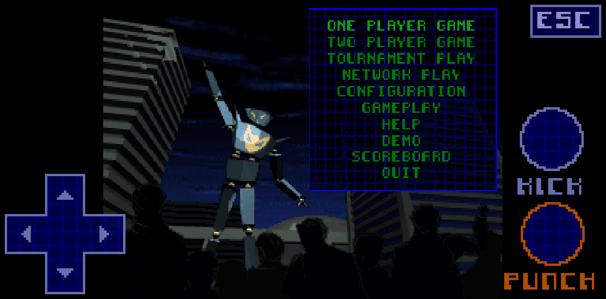
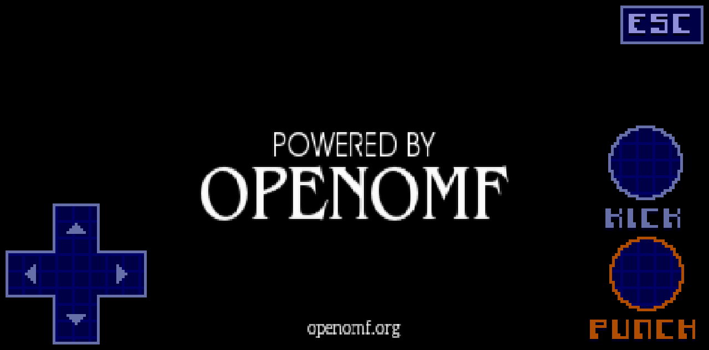
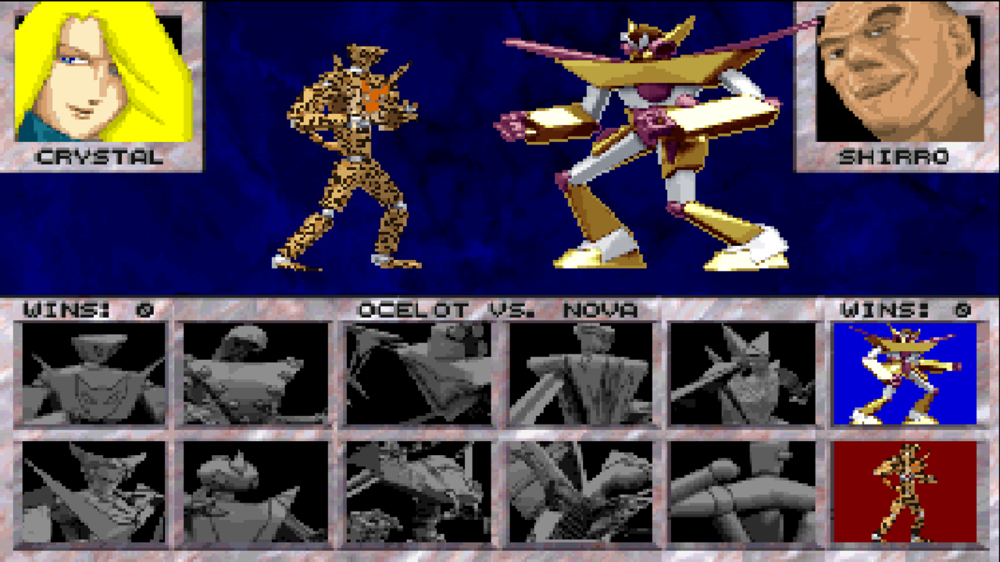
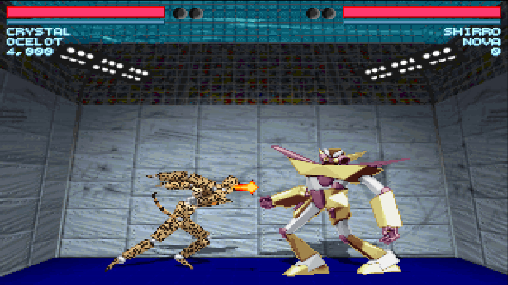
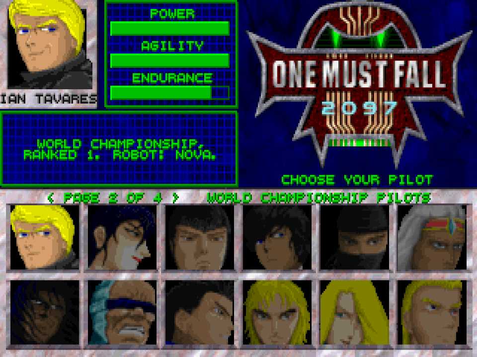
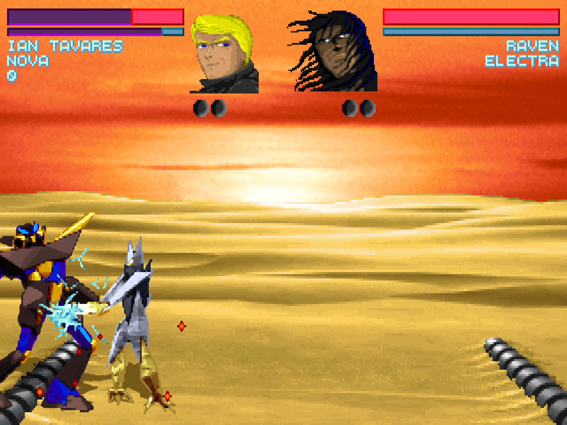

<div align="center">

# ONE MUST FALL 2097

### The 1994 robot fighting classic, running natively in your browser

**English** · [Italiano](README.it.md)


[](https://mich-de.github.io/openomf2097/)

**▶ [Play it now in your browser → mich-de.github.io/openomf2097](https://mich-de.github.io/openomf2097/)**


*Native WebAssembly build (OpenOMF): no emulator, WebGL2, the game's own 320x200 frame.*

</div>

---

## Play online

No install needed: open **https://mich-de.github.io/openomf2097/** and press **PLAY (WASM, NO EMULATOR)**. The page fetches the engine and the game data (~19 MB the first time, then cached by the browser with a new cache entry after every deploy) and boots straight into the game. No DOS, no emulator: this is [OpenOMF](https://github.com/omf2097/openomf), the open reimplementation, compiled to WebAssembly.

- **Keyboard:** player 1 uses the arrows, `Enter` to punch, `Right Shift` to kick. Player 2 plays on `WASD` + `QEZC`, `Left Ctrl` to punch, `Left Shift` to kick. `Esc` opens the menu, `Enter` confirms. `F11` or **FULL SCREEN** for full screen.
- **Phone and tablet:** an on-screen pad appears in the corners — cross pad bottom left, **PUNCH** and **KICK** bottom right, **ESC** top right. The pad sends the same keys as the keyboard, so the game cannot tell the difference.
- **Single player and local two-player** are both supported; online play is not wired up (the menu's NETWORK PLAY needs a server this site doesn't run).
- **Company networks:** web filters such as Zscaler may cut the download (the data pack looks like an archive of DOS programs to them). The page says so and offers to try again; the fix is another network, or asking IT to allow `mich-de.github.io`.

One Must Fall 2097 has been freeware since 1999. This repo is also the site: GitHub Pages serves it straight from the root.

## Gameplay

| | |
|:---:|:---:|
| <br>Main menu, native build | <br>Ten pilots to choose from |
| <br>Trash talk before the fight | <br>Live fight with HUD and health bars |
| <br>Phone: menu with the on-screen pad | <br>Phone: splash, controls in the corners |
| <br>Twelve robots: Nova and Ocelot in a sixth column | <br>Ocelot spits fire |
| <br>The World Championship's pilots, Fire and Ice, on three more pages | <br>Ian Tavares, the world champion, and his Nova |

## Quick start

```bash
git clone https://github.com/mich-de/openomf2097.git
cd openomf2097
python3 -m http.server 8734
```

Open **http://127.0.0.1:8734/** and press **PLAY (WASM, NO EMULATOR)**. Add `?touch=1` to the address to try the mobile controls on a computer (`?touch=0` hides them).

## Highlights

- **Native, no emulator.** The game itself — [OpenOMF](https://github.com/omf2097/openomf) in C with SDL2 — compiled to WebAssembly and rendered on WebGL2. Menus, fights and music run in the page: no DOS, no js-dos, no emulated CPU.
- **One page for desktop and mobile.** Touch screens get an on-screen pad and buttons; keyboards just work.
- **A pad made for fighting.** It synthesises the keyboard's own DOM keys, so the engine sees exactly what a player 1 would press. A diagonal holds two arrows, as on a keyboard, so rolling the thumb from down to down-back only adds back and never passes through neutral mid-move. The down diagonals (crouch block, quarter circles) get wider sectors, and each direction holds until the thumb is 10° past its edge, so a wobbling thumb doesn't flicker between two directions.
- **A launcher made of the game's own art.** Background, lettering and panels come from the 1994 NetArena screens shipped with the game; the touch buttons are drawn pixel by pixel with the same bitmap font.
- **No stale engine, ever.** The page pins `openomf.js`, `openomf.wasm` and `openomf.data` by ETag, so every deploy is a new cache entry and returning players never keep an old engine.

## The native WebAssembly build

`index.html` runs the game as WebAssembly instead of emulating the machine it was written for:

- **The engine.** [OpenOMF](https://github.com/omf2097/openomf) (C, SDL2) pinned at commit `4fd5be9`, compiled with Emscripten. SDL2, SDL2_mixer, libpng and zlib come from the Emscripten ports; enet, libxmp and libconfuse are built as static WebAssembly libraries; libepoxy is replaced by a small shim that serves `epoxy/gl.h` as GLES3, which is what WebGL2 speaks.
- **Shaders.** The GLSL 3.00 shaders are translated for GL ES at build time (in `tools/web/build_openomf.sh`): `highp usampler2D`, no redeclared `gl_FragCoord`, no `int`/`float` mixing, `textureLod` bias as a float.
- **Colour.** WebGL2 cannot render to `RGBA16`, so the palette-index render target is `RGBA16F`; the half-float mantissa keeps every index exact because the decode quantizes with `int(v * 1023.0 + 0.5)`. The remap channel is rounded the same way (`int(v * 255.0 + 0.5)`): truncated, a half-float 233/255 read back as 232, the wrong remap table, and Shadow's shadows came out solid black instead of dark and detailed.
- **Timing.** GitHub Pages serves no `COOP`/`COEP` headers, so threads are out and `SDL_Delay` would busy-wait. The build uses ASYNCIFY with a blocking main loop: each frame ends in `emscripten_sleep`, paced to 60 Hz against `emscripten_get_now`.
- **The console.** The in-game console reads stdin with `read(0, ...)`, which never returns in a browser and froze the tab; it is skipped under `__EMSCRIPTEN__`. The console log goes to `window.__omflog` instead (`omf-debug.html` shows it alone).
- **Language files.** `ENGLISH.DAT2`/`GERMAN.DAT2` cannot be generated by the wasm `languagetool` (it runs at build time), so a host-built copy of the tool produces them and they ship in the data pack; without them `lang_init()` aborts.
- **Files.** Game data is packed into `openomf.data`; scores and config live in browser storage. The first load pulls `openomf.js` (239 KB), `openomf.wasm` (~3.1 MB) and `openomf.data` (~15.4 MB), each pinned by ETag so a deploy never leaves a stale copy behind.
- **Twelve robots.** The robot select screen has a sixth column: Nova on top, so she can be picked like any other robot (the katana cheat still works too), and Ocelot below. `MELEE.BK` only has art for ten robots: the marble grid is re-cut from the background at load time (cells 51px → 46px wide), and the two extra portraits and idle animations come from their `.AF` files. The pilot page keeps its five columns.
- **Ocelot.** A twelfth robot, new to this build: Jaguar repainted by hand as a jaguar, with a spotted coat, a cat's head and a tail, and a fire spit in place of the concussion cannon (down, down-back, back + punch). The 154 frames live in `tools/web/ocelot/art` as 4x PNGs, one per Jaguar sprite; at build time `tools/web/ocelot/ocelot.c` shrinks them back to the game's pixels and writes `FIGHTR11.AF` (the moves), `FIGHTR11.X16` (16-bit pixels with every one of the art's colors, 174 of them) and a spotted portrait in `VS.BK`. Ocelot fights with Jaguar's moves and the AI plays it as Jaguar. It is a melee robot: tournament mode keeps the original ten.
- **TIGRIS.** Ocelot in a tiger's coat, on the robot grid's second page: orange fur, white where Ocelot is palest and black stripes instead of spots, painted over Ocelot's art by `tools/web/tigris/tigris.c` (the stripes run across the robot where it stands, so they stay put from frame to frame as far as its limbs do).
- **Full HD and beyond.** The canvas takes the screen's real pixels (1920x1080 on a full HD screen in full screen, more on high-DPI ones) and the game draws into a framebuffer about as tall, 6x the original 320x200 for 1080p, then fits it to the screen in 4:3 like the original monitor. Resizing the window or going full screen re-fits it.
- **Two more pilots: Jaguar and Tiger.** A sixth column on the pilot page too: a jaguar and a tiger who pilot robots, with stats, an AI personality (Jaguar pounces from the air, Tiger presses forward), bios, VS lines and endings; they are opponents in single player too. Their robots come in their coats: Jaguar's starts on Ocelot, Tiger's on TIGRIS, and on any other robot they wear ramps taken from the World Championship's robots (ICEMAN's gold, Raven's near black and Bethany's sand; Eva Earlong's orange, Raven's black and Angel's silver). Their portraits (`tools/web/pilots/art`, drawn with `tools/web/pilots/src/catface.py`) use 64 colors of their own each from the extended palette, since the menus' 256 have no room left.
- **The World Championship's pilots, Fire and Ice.** The 25 pilots of the tournament mode's World Championship (`WORLD.TRN`) who are not among the original ten are playable in one and two player games, on three more pages of the pilot grid (a "PAGE 1 OF 4" line and blinking arrows at the edges; go past the edge for the next page): Ian Tavares, Nicoli, Bethany, ICEMAN, Jazzy and the others, with the tournament's photos, quotes and AI, and their robots in the three colors drawn for each of them (kept with their photos, as the tournament paints them). Their own robot is already chosen on the robot page (Nova for the champions), and their stats are the tournament's on the select screen's scale, so the World Championship's best are stronger than the original ten. The last page also has the single player game's two secret opponents, which the original only shows on Deadly and Ultimate after a destruction and a Fire/Ice move in the Fire Pit: **Fire**, whose Katana is painted in flames, and **Ice**, whose Shadow is painted in ice; both have every upgrade and take their robots' colors from the Fire Pit's own palettes, and when the fight is in the Fire Pit it burns orange for Fire and freezes blue for Ice. In single player the opponents stay the twelve pilots of the first page (`tools/web/tournament-pilots.patch`; `tools/web/tournament/trnfaces.c` turns the photos into faces and icons in the menus' own colors; Fire's and Ice's are Nicoli's, already lit red on one side and blue on the other, repainted in flames and ice). With faces in the fight, the round tokens sit beside them.
- **46 fan-made tournaments.** The tournaments One Must Fall's players made between 1995 and 2002 (Elite World Championship, The Mantis Project, The Revenge of Anakonda, Northern Lights, World Championship 2 and the others, as collected on X-BoT's OMF Universe) are in the tournament mode's list next to the original four. Their files are as their authors made them but for the names of their photo files, so that no two clash (`tools/web/tournaments`, with the authors); a pilot whose photo is missing from its tournament gets the first one instead of crashing the game.
- **Two hacked robots: SUPERJAG and SHADOW X.** Robots the players made by editing the original files: Ilya's souped-up Jaguar (2000), with an earthquake, a spinner, an exploding spit, breakthroughs, Nova's air-to-ground rocket and Chronos's teleport, and a Shadow with simpler moves and a double shadow dive. They are on the robot grid's second page (past its edge, like the pilot pages), with their moves listed in `tools/web/hacked/README.md`.
- **Faces in the arena.** In single player the HUD shows both pilots' faces, as the original does in tournaments, with the round lights below them.
- **Full screen, maximum detail.** PLAY goes full screen in landscape (locked where the browser allows it, as Android does) with the framebuffer at 6x and robots at 4x; the detail drops while playing only if the frame rate can't keep up, and WebGL in software starts low. The VIDEO menu's choices (FB SCALE, with a new AUTO; SCALING; ASPECT) are kept in the browser and used at every start, on phones too; `?quality=low|mid|high` forces a level, `?debug=1` shows the GPU, sizes and the engine's log. Rehit is on by default.
- **Colors beyond 256.** The original game gives a robot the pilot's 47 colors. OpenOMF already renders through a 1024 entry palette, so this build lets a robot bring its own: a `.X16` file next to its `.AF` holds 16-bit pixels and up to 383 colors per player (player 1's at palette entries 257..639, player 2's at 641..1023; the palette shader moves player 2's, as it moves the pilot ramps). Lighting, hit flashes and fades reach those colors too, and hit detection counts them as the robot's body.
- **Tournament powers in every mode.** In the original, a robot's enhancements (bought in tournament mode) change its special moves: Shadow throws its shadows farther and gets a freezing shadow (down-forward, down, down-back, back + punch), Katana adds blades, and so on. Outside the tournament this build gives every robot all three enhancements, for both players and the AI; the tournament keeps the levels you buy. Shadow's shadow grab (down, down + punch) holds its victim frozen until the shadow lets go: the engine only stopped the victim from moving, so it kept walking, turning and attacking inside the shadow; the shadows of the hacked Shadow X hold too (`tools/web/tournament-pilots.patch`).
- **Kreissack on every difficulty.** In single player, beating everyone leads to Major Kreissack on Rookie too; the original sent you home below Veteran.
- **Patch.** Every source change is a patch in `tools/web/` applied by the build script against the pinned checkout, so the build stays reproducible.

```bash
source ~/emsdk/emsdk_env.sh
tools/web/build_deps.sh      # once: enet, libxmp, libconfuse
tools/web/build_openomf.sh   # clones/pins OpenOMF, patches, builds, copies into wasm/
# OMF_EM_DEBUG=1 tools/web/build_openomf.sh   # assertions and logging build
```

## Touch controls, and how they reach the engine

The engine reads SDL2 keyboard events from the DOM, so the pad does not invent a new protocol: it synthesises the same `KeyboardEvent`s a keyboard would send, with the legacy `keyCode` SDL still reads, and dispatches them on the game canvas. A press is one `keydown`, a release one `keyup`; the held set makes a direction change press the new arrow before releasing the old one, exactly like two keys overlapping on a keyboard.

| Button | Sends |
|---|---|
| Cross pad | Arrow keys (diagonals hold two) |
| **PUNCH** | `Enter` |
| **KICK** | `Right Shift` (`code: "ShiftRight"`) |
| **ESC** | `Esc` |

When the game asks for a name (a new tournament pilot, a high score, the network screens) the pad and buttons give way to an **on-screen keyboard** in the same pixel style: letters, digits, a lower case key, SPACE, DEL and OK. The engine tells the page a text field is waiting by calling `Module.omfTextField()` every frame it draws one (`game/gui/textinput.c`, in `tools/web/tournament-pilots.patch`); the keyboard stays while the calls keep coming. Letters go to the game as `keypress` events, which SDL turns into text input without the key presses the controls would read; DEL is `Backspace` and OK is `Enter`.

The controls appear on touch screens automatically; `?touch=1` forces them on and `?touch=0` off. All keys are released on window blur and on `visibilitychange`, so a stray thumb can't leave the game walking.

## Built with

| What | Used for |
|---|---|
| [OpenOMF](https://github.com/omf2097/openomf), pinned at `4fd5be9` | The game engine, compiled to WebAssembly: menus, fights, music, saves |
| Emscripten (SDL2, SDL2_mixer, libpng, zlib ports) | The toolchain and its system libraries |
| enet, libxmp, libconfuse, built as static WebAssembly libraries | Networking sources, module music (`.PSM`), config files |
| WebGL2 | The renderer, via a GLES3 shim for libepoxy |
| GitHub Pages | Hosting, straight from the root of this repo |
| [REA](https://github.com/morluto/rea) + Chrome DevTools Protocol | Headless browser tests: keys, touches, screenshots, network logs |
| [fontTools](https://github.com/fonttools/fonttools) | Turning the game's bitmap fonts into TTF and WOFF2 |

## The game's fonts, as real font files


The game's bitmap fonts, converted to TTF and WOFF2 in [`assets/fonts/`](assets/fonts/). Each pixel is a square outline, so they stay crisp at their cell size and whole multiples of it.

| Font | From | Cell | Characters |
|---|---|---|---|
| **OMF 2097 NetArena** | `NETFONT1.PCX`, the NetArena lettering of the launcher | 9 px, proportional | ASCII |
| **OMF 2097 Big** | `GRAPHCHR.DAT`, the game's menu and HUD font | 8x8 px | ASCII + code page 437 letters and symbols |
| **OMF 2097 Small** | `CHARSMAL.DAT`, the game's small font | 6x6 px | ASCII (capitals only) + code page 437 letters |

```css
@font-face { font-family: "OMF 2097 Big"; src: url(assets/fonts/omf2097-big.woff2) format("woff2"); }
h1 { font: 32px "OMF 2097 Big"; } /* 4 x 8 px: every pixel lands on whole screen pixels */
```

Rebuild them with `pip install fonttools brotli`, then `python3 tools/build_fonts.py`.

## How it was tested

- **The native build, screenshot by screenshot.** `cdp_shot.js` boots the page in headless Chrome, clicks **PLAY**, holds each key long enough for the polled menu (`SDL_GetKeyboardState` reads the state, so a tapped key is missed) and captures splash → main menu → character select → live fight with HUD, health bars and projectiles. Headless WebGL needs `--use-gl=angle --use-angle=swiftshader --enable-unsafe-swiftshader`.
- **The pad, with real touches.** The Chrome DevTools Protocol sends actual `touchStart`/`touchEnd` points at the pad's arms and buttons: holding the right arm and pressing PUNCH walks the game from splash to main menu to the robot selection screen, and the ESC button quits cleanly (`GAME CLOSED (code 0)`).
- **An opponent that stands still.** Moves and diagonals were checked in a TWO PLAYER GAME, where player 2 never touches a key.
- **Menus that skip.** The game's menus sometimes take one key press twice, so scripts read the highlighted line from the frame (the brightest one) and correct the cursor before confirming.

## What's in the repo

| Path | What it is |
|---|---|
| `index.html` | The game page: PLAY button, launcher, keyboard and touch controls |
| `netfont.js` | The `NETFONT1.PCX` bitmap font, drawn pixel by pixel: launcher lettering and touch buttons |
| `wasm/` | The native build served by the page: `openomf.js`, `openomf.wasm`, `openomf.data` |
| `tools/web/` | Web build script, guarded patches (GL probe, RGBA16F, stdin, frame pacing, opus), GLES3 shim, stage probe |
| `omf-debug.html` | Minimal log-only harness for the native build (`window.__omflog`) |
| `assets/` | Launcher art taken from the game (`NETMEGA.PCX` background, logo) |
| `assets/fonts/` | The game's three bitmap fonts as TTF and WOFF2, plus a specimen |
| `cdp_shot.js` | Drives Chrome over CDP: load, wait, click, screenshot, evaluate |
| `screenshots/` | Gameplay shots and the development screenshots shown above |

## Tools

```bash
# Rebuild the native WebAssembly build (once: enet, libxmp, libconfuse)
source ~/emsdk/emsdk_env.sh
tools/web/build_deps.sh
tools/web/build_openomf.sh        # OMF_EM_DEBUG=1 to build with assertions

# Screenshot the page in real Chrome
google-chrome-stable --headless=new --remote-debugging-port=9333 --remote-allow-origins='*' --window-size=1280,720 about:blank &
node cdp_shot.js "http://127.0.0.1:8734/" 20000 out.png [x,y] [waitAfterClickMs]
```
